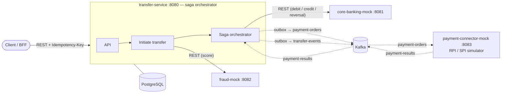

# Transfer Saga — orchestrated saga exercise with Quarkus

A hands-on implementation of the **Transfer Service L3 component diagram** from the
[digital-banking-platform](../digital-banking-platform/c4/diagramas/03-componentes-transferencias.png) proposal:
an **orchestrated saga** with **idempotency**, **transactional outbox**, **rail routing** and **compensations**,
built as four microservices with **Java 25**, **Quarkus 3.40**, **Gradle 9** and **hexagonal architecture**.

The goal is to practise the saga, not to build a bank: the core banking system, the fraud engine and the
central bank connector are mocks that can be told to fail in every way a real one does.



## What you can practise here

| Pattern | Where it lives |
|---|---|
| Orchestrated saga as a persisted state machine | [`Transfer`](services/transfer-service/src/main/java/ec/fin/transfer/domain/model/Transfer.java), [`SagaOrchestrator`](services/transfer-service/src/main/java/ec/fin/transfer/application/service/SagaOrchestrator.java) |
| Compensations (reverse credit and debit) | `Transfer.startCompensation`, `SagaCommand.Compensate` |
| Idempotent API (`Idempotency-Key`, request fingerprint, 409 on reuse) | [`InitiateTransferService`](services/transfer-service/src/main/java/ec/fin/transfer/application/service/InitiateTransferService.java) |
| Idempotent participants (deterministic operation ids, tombstones) | `Transfer.debitOperationId()`, [`LedgerService`](services/core-banking-mock/src/main/java/ec/fin/corebanking/application/service/LedgerService.java) |
| Transactional outbox + relay (`FOR UPDATE SKIP LOCKED`) | [`outbox/`](services/transfer-service/src/main/java/ec/fin/transfer/infrastructure/adapter/out/messaging/outbox) |
| Retries with persisted exponential backoff | `Transfer.stepFailedTransiently`, `SagaPolicy` |
| Timeouts vs. compensation (unknown outcome → manual reconciliation) | `Transfer.paymentResultTimedOut` |
| Optimistic locking between concurrent workers | `@Version` + `TransferPersistenceAdapter.save` |
| Circuit breaker and timeouts (SmallRye Fault Tolerance) | [`CoreBankingGateway`](services/transfer-service/src/main/java/ec/fin/transfer/infrastructure/adapter/out/ledger/CoreBankingGateway.java) |
| Rail routing with the Strategy pattern (own bank / instant RPI / deferred SPI) | [`RailRouter`](services/transfer-service/src/main/java/ec/fin/transfer/domain/service/RailRouter.java) + one `RailRoutingRule` per rail ([ADR-006](docs/adr/ADR-006-rail-routing-strategy.md)) |
| Dead letter queues | `failure-strategy=dead-letter-queue` on every consumer |
| Chaos engineering on the participant | `PUT /core/v1/admin/chaos` |

## Repository layout

```
.
├── build-logic/                 Gradle convention plugins (Java 25 toolchain, Lombok, Quarkus, OpenAPI codegen)
├── contracts/openapi/           API-first contracts: transfer, core banking, fraud (single source of truth)
├── libs/
│   ├── commons/                 Framework-free error types shared by every domain
│   ├── commons-web/             RFC 9457 problem details, correlation id filters (server + client)
│   ├── messaging-contracts/     Kafka message records and topic names
│   └── architecture-rules/      ArchUnit rules that enforce the hexagonal dependency rule
├── services/
│   ├── transfer-service/        The saga orchestrator (PostgreSQL + Liquibase + Kafka)
│   ├── core-banking-mock/       Ledger with idempotent postings, reversals and chaos injection
│   ├── fraud-mock/              Deterministic risk scoring
│   └── payment-connector-mock/  Central bank (RPI/SPI) simulator over Kafka
├── docs/                        Architecture, saga walkthrough, testing guide, ADRs
├── http/transfers.http          Ready-to-run requests (VS Code REST Client / IntelliJ HTTP client)
├── scripts/                     start-all.ps1 / stop-all.ps1
└── docker-compose.yml           PostgreSQL, Kafka, topic creation and Kafka UI
```

Each service follows the same hexagonal layout:

```
ec.fin.<service>
├── domain/            entities, value objects, domain services, events — plain Java
├── application/
│   ├── port/in/       use case interfaces (what the service offers)
│   ├── port/out/      ports the use cases need (repositories, participants, transactions)
│   └── service/       use case implementations — plain Java, no framework annotations
└── infrastructure/
    ├── adapter/in/    REST resources (implement generated interfaces), Kafka consumers, schedulers
    ├── adapter/out/   persistence, REST clients (generated), Kafka publishers, outbox
    └── config/        composition root (CDI producers) and typed configuration
```

## Tech stack

| Concern | Choice |
|---|---|
| Language / runtime | Java 25 LTS, virtual threads (`@RunOnVirtualThread`) |
| Framework | Quarkus 3.40.1.2 (Quarkus REST, ArC, SmallRye) |
| Build | Gradle 9.9.1 (wrapper), Kotlin DSL, version catalog, convention plugins in `build-logic` |
| API | OpenAPI 3 contracts, `openapi-generator` 7.27 (JAX-RS interfaces + MicroProfile REST clients) |
| Persistence | PostgreSQL 18, Hibernate ORM with Panache repositories, Liquibase migrations, schema validation |
| Messaging | Apache Kafka 4.4 via SmallRye Reactive Messaging |
| Resilience | SmallRye Fault Tolerance (timeouts, circuit breakers), persisted retries in the saga |
| Errors | RFC 9457 problem details with stable error codes, no stack traces |
| Tests | JUnit 6, AssertJ, Mockito, REST Assured, Awaitility, Testcontainers (Dev Services), ArchUnit |
| Boilerplate | Lombok |

## Quick start

### Prerequisites

- JDK 25 (`java -version`)
- Docker Desktop running (Dev Services and docker compose both use it)
- Free ports 8080-8083; plus 5433 in dev mode, or 5432, 8090 and 9092 in prod mode

There are two ways to run the system. Use **dev mode** to explore and change code, **prod mode** to run it as it would
be deployed.

### Option A — Quarkus dev mode (recommended, no docker compose)

One terminal per service. Start `transfer-service` first:

```bash
./gradlew :services:transfer-service:quarkusDev -Ddebug=5005
./gradlew :services:core-banking-mock:quarkusDev -Ddebug=5006
./gradlew :services:fraud-mock:quarkusDev -Ddebug=5007
./gradlew :services:payment-connector-mock:quarkusDev -Ddebug=5008
```

What Quarkus gives you in dev mode:

- **Dev Services** start PostgreSQL 18 (fixed port `5433`, user/password/db `transfers`) and a Kafka broker with the
  `payment-orders`, `payment-results` and `transfer-events` topics. The broker is **shared**: the payment connector
  finds the one the transfer service started. Containers are removed when the services stop.
- **Live reload**: edit any class and the next request recompiles and restarts in about a second.
- **Dev UI** at `http://localhost:808x/q/dev-ui`: CDI beans, configuration, Dev Services, Hibernate entities, Liquibase
  changelog, scheduled jobs, Kafka topics and messages, REST endpoints.
- **Continuous testing**: press `r` in the terminal to run the tests of that service on every change.
- `-Ddebug=500x` gives each service its own remote debug port.

### Option C — IntelliJ IDEA (docker compose infrastructure + services in the IDE)

```bash
docker compose up -d     # PostgreSQL, Kafka and Kafka UI only
```

The shared run configurations in `.run/` appear in IntelliJ automatically:

1. **1. Run services → `<service> (dev)`** runs `quarkusDev` with the `local` profile: dev mode (live reload,
   Dev UI) wired to the docker-compose PostgreSQL and Kafka instead of Dev Services containers.
2. **2. Attach debugger → `<service> (attach debugger)`** attaches to ports 5005–5008 and reconnects on its own.

There are no `main` classes on purpose: Quarkus generates the entry point at build time, and launching a
`@QuarkusMain` from the IDE in a Gradle build fails with class loader conflicts in dev mode.

### Option B — prod mode (jars + docker compose)

```bash
docker compose up -d     # PostgreSQL :5432, Kafka :9092, topics (kafka-init), Kafka UI http://localhost:8090
```

Windows PowerShell, one command:

```powershell
./scripts/start-all.ps1          # builds, starts the 4 jars in background, waits until ready
./scripts/stop-all.ps1           # stops them; logs are in ./logs
```

Any OS:

```bash
./gradlew assemble -x test
java -jar services/core-banking-mock/build/quarkus-app/quarkus-run.jar
java -jar services/fraud-mock/build/quarkus-app/quarkus-run.jar
java -jar services/payment-connector-mock/build/quarkus-app/quarkus-run.jar
DB_PASSWORD=transfers SWAGGER_UI_ENABLED=true java -jar services/transfer-service/build/quarkus-app/quarkus-run.jar
```

In prod mode the transfer service has no default database password and serves Swagger UI only when
`SWAGGER_UI_ENABLED=true`; `start-all.ps1` sets both for local use.

| Service | URL | Swagger UI |
|---|---|---|
| transfer-service | http://localhost:8080 | http://localhost:8080/q/swagger-ui |
| core-banking-mock | http://localhost:8081 | http://localhost:8081/q/swagger-ui |
| fraud-mock | http://localhost:8082 | http://localhost:8082/q/swagger-ui |
| payment-connector-mock | http://localhost:8083 | health only: `/q/health` |
| Kafka UI | http://localhost:8090 | |

### 3. Run your first saga

```bash
curl -i -X POST http://localhost:8080/api/v1/transfers \
  -H "Content-Type: application/json" \
  -H "Idempotency-Key: 7d3c2a51-first-transfer" \
  -d '{"customerId":"C-100","sourceAccount":"1000000001",
       "beneficiary":{"bankCode":"010","accountNumber":"3000000001","holderName":"Carlos Vega"},
       "amount":50.00,"currency":"USD","concept":"Dinner"}'
```

The answer is `202 Accepted` with `status: PENDING` and a `Location` header. Follow the saga:

```bash
curl http://localhost:8080/api/v1/transfers/<transferId>
```

`saga.steps` shows the journal: `RISK_CHECK → DEBIT → PAYMENT_ORDER → PAYMENT_RESULT`, and `status` becomes `COMPLETED`.

Every scenario (happy paths, rejections, compensations, chaos, lost payments) is in
[docs/testing-guide.md](docs/testing-guide.md) and ready to click in [http/transfers.http](http/transfers.http).

## Automated tests

```bash
./gradlew build          # compiles, generates code from the contracts and runs every test
./gradlew test --tests '*TransferSagaTest*'   # just the saga state machine
```

| Level | What it proves | Needs Docker |
|---|---|---|
| Domain unit tests (`TransferSagaTest`, `RailRouterTest`, `RiskPolicyTest`, `LedgerServiceTest`…) | every saga transition, backoff, compensation order, idempotency rules | no |
| Architecture tests (`ArchitectureTest` in each service) | domain and application never depend on Quarkus, Jakarta, Hibernate, Jackson or Kafka; layers only point inwards | no |
| Integration (`TransferSagaIT`) | the full saga inside the service with a real PostgreSQL (Testcontainers), real outbox and scheduler; participants mocked at their ports, Kafka replaced by the in-memory connector | yes |
| REST tests (`LedgerResourceTest`) | contract, status codes and problem details of the core mock | no |
| Manual end-to-end | four real services, Kafka and PostgreSQL, chaos injection | yes |

## Documentation

- [Architecture](docs/architecture.md): C4 views, hexagonal structure, data model and the mapping to the L3 diagram.
- [Saga walkthrough](docs/saga.md): state machine, sequence diagrams for every path, and the design decisions behind them.
- [Testing guide](docs/testing-guide.md): seeded accounts, scenario catalogue, chaos experiments, how to observe Kafka and the database.
- [Architecture decision records](docs/adr/README.md).
- [Review guide](docs/review-guide.md): technology inventory and a step-by-step checklist with every command to validate the solution.

## Differences from the target AWS design

This is a local exercise, so a few infrastructure choices differ from the platform proposal, always behind a port so the
domain does not change (see the ADRs):

| Target (platform proposal) | Here | Why |
|---|---|---|
| EventBridge + SQS (FIFO for payment orders) | Kafka, keyed by transfer id | runs locally; key-based partitioning gives the same per-transfer ordering as an SQS FIFO message group |
| Spring Boot WebFlux + R2DBC | Quarkus + Hibernate ORM on virtual threads | the exercise is about Quarkus; virtual threads give reactive-level concurrency with simpler, transactional code |
| Aurora PostgreSQL | PostgreSQL 18 container | same engine |
| Real core, fraud engine and BCE connector | mocks with failure injection | the saga is the subject under test |
