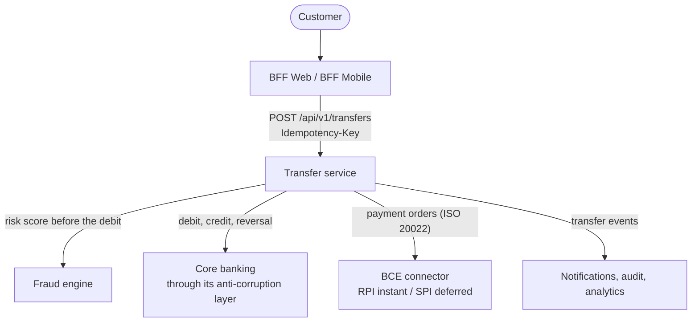
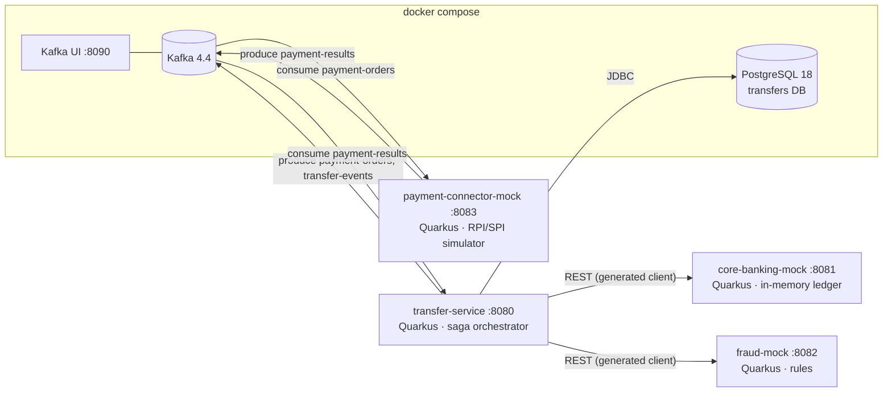
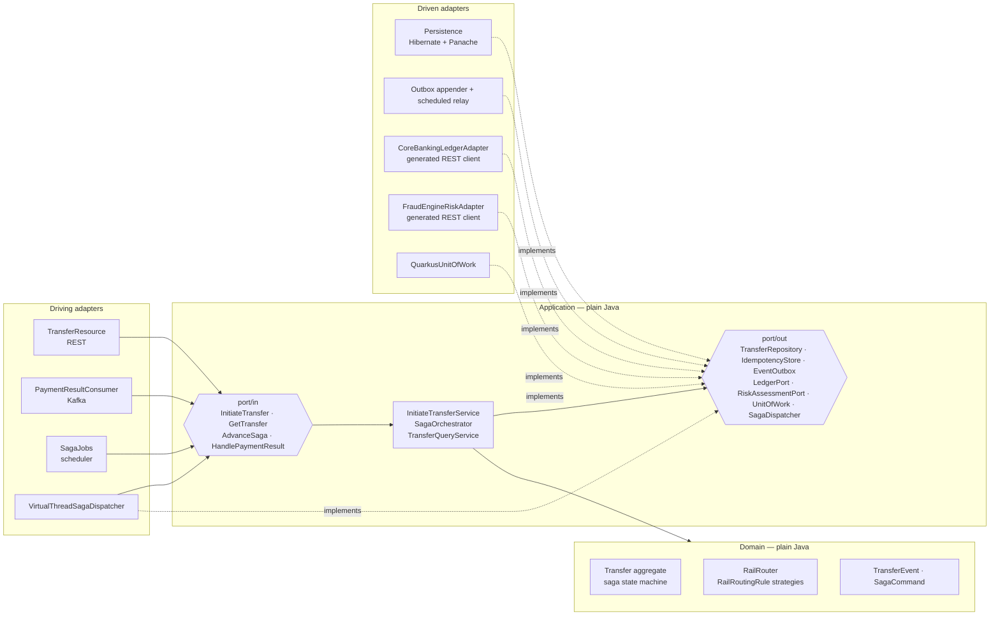
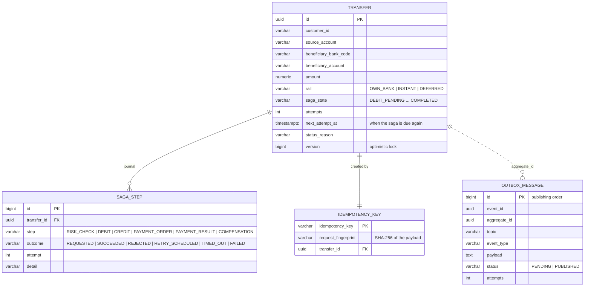
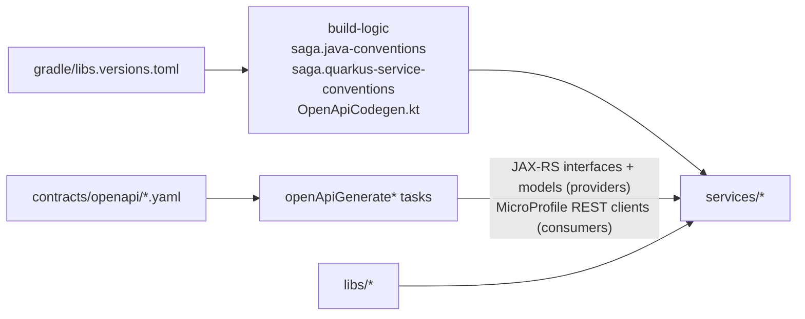

# Architecture

## 1. Context

The transfer service receives transfer requests from the channel BFFs and coordinates three systems that share no
transaction: the core banking ledger, the fraud engine and the central bank (BCE) clearing networks.

## 2. Containers

| Topic | Producer | Consumer | Key | Purpose |
|---|---|---|---|---|
| `payment-orders` | transfer-service (outbox) | payment-connector-mock | transfer id | command to clear an interbank payment |
| `payment-results` | payment-connector-mock | transfer-service | transfer id | settlement or rejection (ISO 20022 reason code) |
| `transfer-events` | transfer-service (outbox) | anyone (Kafka UI here) | transfer id | integration events: accepted, debited, completed, reversed, failed |
| `*-dlq` | SmallRye | operators | — | messages that keep failing |

## 3. Components of the transfer service (L3)

The implementation follows the L3 diagram of the platform proposal one to one:

| L3 component | Implementation |
|---|---|
| API de Transferencias | [`TransferResource`](../services/transfer-service/src/main/java/ec/fin/transfer/infrastructure/adapter/in/rest/TransferResource.java), implementing the `TransfersApi` interface generated from [`transfer-api.yaml`](../contracts/openapi/transfer-api.yaml) |
| Guardián de Idempotencia | `InitiateTransferService.replayOf` + [`IdempotencyPersistenceAdapter`](../services/transfer-service/src/main/java/ec/fin/transfer/infrastructure/adapter/out/persistence/IdempotencyPersistenceAdapter.java) (primary key on the idempotency key) |
| Iniciar Transferencia | [`InitiateTransferService`](../services/transfer-service/src/main/java/ec/fin/transfer/application/service/InitiateTransferService.java) |
| Router de Rieles | [`RailRouter`](../services/transfer-service/src/main/java/ec/fin/transfer/domain/service/RailRouter.java) with one `RailRoutingRule` strategy per rail ([ADR-006](adr/ADR-006-rail-routing-strategy.md)) |
| Orquestador de Saga | [`SagaOrchestrator`](../services/transfer-service/src/main/java/ec/fin/transfer/application/service/SagaOrchestrator.java) + the state machine in [`Transfer`](../services/transfer-service/src/main/java/ec/fin/transfer/domain/model/Transfer.java) |
| Adaptador Antifraude | [`FraudEngineRiskAdapter`](../services/transfer-service/src/main/java/ec/fin/transfer/infrastructure/adapter/out/risk/FraudEngineRiskAdapter.java) + `FraudEngineGateway` |
| Adaptador Ledger | [`CoreBankingLedgerAdapter`](../services/transfer-service/src/main/java/ec/fin/transfer/infrastructure/adapter/out/ledger/CoreBankingLedgerAdapter.java) + `CoreBankingGateway` |
| Repositorio | [`TransferPersistenceAdapter`](../services/transfer-service/src/main/java/ec/fin/transfer/infrastructure/adapter/out/persistence/TransferPersistenceAdapter.java), [`OutboxEventAppender`](../services/transfer-service/src/main/java/ec/fin/transfer/infrastructure/adapter/out/messaging/outbox/OutboxEventAppender.java), [`QuarkusUnitOfWork`](../services/transfer-service/src/main/java/ec/fin/transfer/infrastructure/adapter/out/persistence/QuarkusUnitOfWork.java) |
| Publicador Outbox | [`OutboxRelay`](../services/transfer-service/src/main/java/ec/fin/transfer/infrastructure/adapter/out/messaging/outbox/OutboxRelay.java) driven by its own [`OutboxRelayJobs`](../services/transfer-service/src/main/java/ec/fin/transfer/infrastructure/adapter/out/messaging/outbox/OutboxRelayJobs.java) schedule |
| Consumidor de Resultados | [`PaymentResultConsumer`](../services/transfer-service/src/main/java/ec/fin/transfer/infrastructure/adapter/in/messaging/PaymentResultConsumer.java) |
| Adaptador Core (ACL) | `core-banking-mock` (canonical ledger contract) |
| Motor Antifraude | `fraud-mock` |
| Conector de Pagos BCE | `payment-connector-mock` |
| Bus de Eventos + Colas por consumidor | Kafka topics with one consumer group per service |

### Hexagonal view

The rules are enforced by [`HexagonalArchitectureRules`](../libs/architecture-rules/src/main/java/ec/fin/architecture/HexagonalArchitectureRules.java):

1. `domain` and `application` do not depend on `jakarta`, `io.quarkus`, `io.smallrye`, `org.hibernate`, `com.fasterxml` or Kafka.
2. `infrastructure` is accessed by nobody; `application` only by `infrastructure`; `domain` by both.
3. The domain does not log: it reports through return values and events.
4. Adapters reach use cases only through `port/in` interfaces, never through `application.service` classes.
5. Driving adapters (`adapter/in`) and driven adapters (`adapter/out`) never depend on each other.
6. `port/in` holds one interface per file, named `*UseCase`; its commands and results are nested in it.
7. `application/service` holds only use case implementations; shared helpers live in their own package
   (for example `application/idempotency`).

Use cases are wired in a composition root (`infrastructure/config/UseCaseConfiguration`) with CDI producers, so they
carry no framework annotation. Transactions are explicit through the `UnitOfWork` port, which keeps every saga step a
short local transaction and guarantees no remote call runs inside one.

## 4. Data model

The schema is owned by Liquibase ([`0001-initial-schema.sql`](../services/transfer-service/src/main/resources/db/changelog/changes/0001-initial-schema.sql));
Hibernate only validates that the mapping matches it (`schema-management.strategy=validate`). Two partial indexes
keep the background jobs cheap: active sagas by `next_attempt_at`, and pending outbox rows.

The customer-facing `status` is never stored: it is derived from `saga_state`, so they can never disagree.

## 5. Build

- `saga.java-conventions`: Java 25 toolchain, Lombok, JUnit platform, compiler flags.
- `saga.quarkus-service-conventions`: Quarkus plugin, the BOM as an enforced platform, the shared libs, the common extensions
  and Jib container images (`-Dquarkus.container-image.build=true`, group `transfer-saga`, tag = project version).
- `openApiServer(...)` / `openApiClient(...)`: generate code into `build/generated/openapi`, add it to the sources, and serve the
  contract itself as the service's OpenAPI document (`mp.openapi.scan.disable=true`): what is published is exactly what was designed.

CI ([`.github/workflows/build.yml`](../.github/workflows/build.yml)) runs `./gradlew build` on every push to `main` and
every pull request, so the architecture rules and the integration tests guard each change.

To add a service: create `services/<name>/build.gradle.kts` with `id("saga.quarkus-service-conventions")`, include it in
`settings.gradle.kts`, add its contract under `contracts/openapi` and call `openApiServer(...)`.
