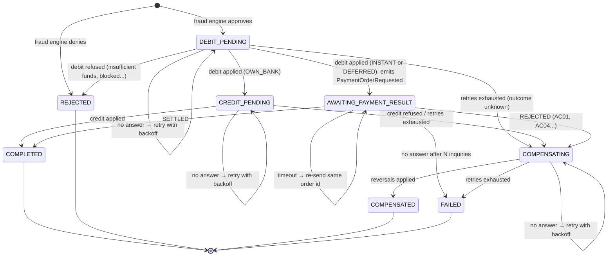
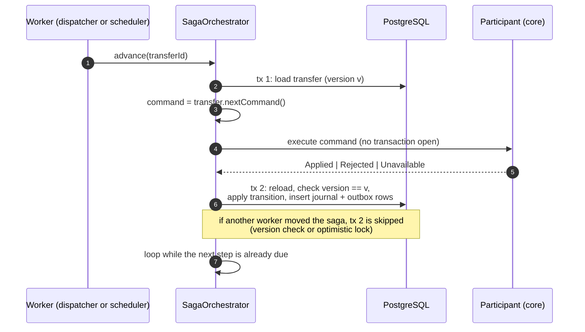
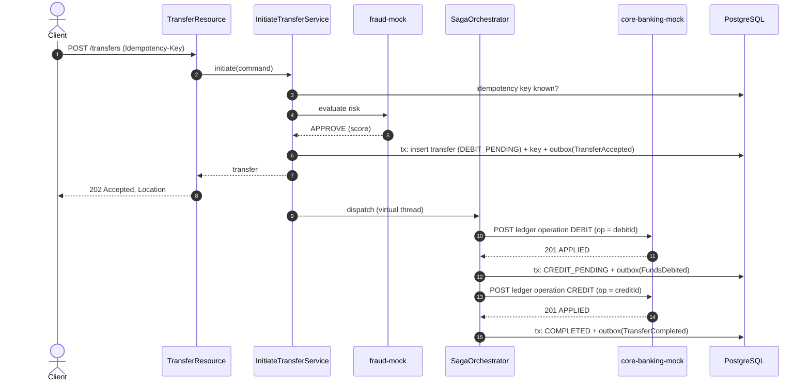
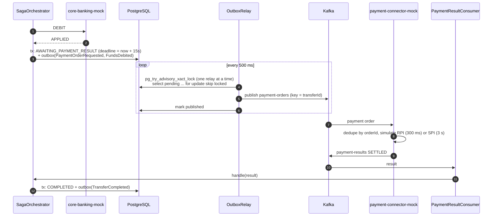
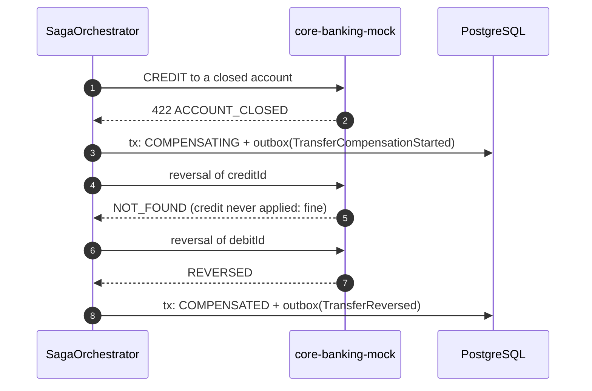
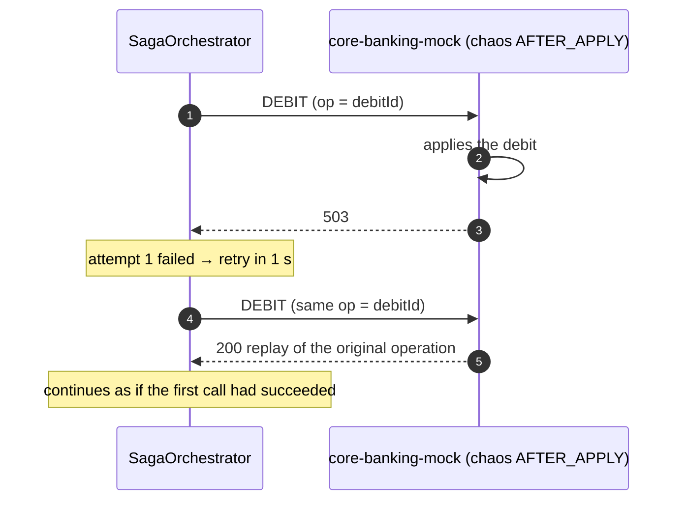

# Saga walkthrough

A transfer touches the core ledger and, for interbank payments, the central bank. There is no transaction that spans
both, so the transfer service runs an **orchestrated saga**: it records every step, decides the next one, and when a
forward step cannot be completed it **compensates** the steps already applied.

## 1. State machine

The whole saga is one aggregate, [`Transfer`](../services/transfer-service/src/main/java/ec/fin/transfer/domain/model/Transfer.java),
written in plain Java and tested without containers ([`TransferSagaTest`](../services/transfer-service/src/test/java/ec/fin/transfer/domain/model/TransferSagaTest.java)).

| Saga state | Customer status | Next command (`Transfer.nextCommand()`) |
|---|---|---|
| `DEBIT_PENDING` | `PENDING` | `Debit(debitOperationId)` |
| `CREDIT_PENDING` | `PENDING` | `Credit(creditOperationId)` |
| `AWAITING_PAYMENT_RESULT` | `PENDING` | `ResolvePaymentTimeout(paymentOrderId)` when the deadline passes |
| `COMPENSATING` | `PENDING` | `Compensate([creditOperationId,] debitOperationId)` |
| `COMPLETED` | `COMPLETED` | — |
| `REJECTED` | `REJECTED` | — |
| `COMPENSATED` | `REVERSED` | — |
| `FAILED` | `FAILED` | — (manual reconciliation) |

## 2. How a step runs

Why it is safe:

- **No remote call inside a transaction.** Connections and row locks are never held while waiting on the network.
- **Every participant call is idempotent.** Operation ids are derived from the transfer id
  (`UUID.nameUUIDFromBytes(transferId + ":debit")`), so a retry, a duplicate worker or a crash between the call and
  tx 2 repeats the same operation, and the core answers with the original result.
- **Lost updates are impossible.** tx 2 checks the version it read in tx 1 and Hibernate's `@Version` guards the
  update itself; the loser simply stops.
- **Nothing gets stuck.** The API dispatches the saga on a virtual thread right after commit, and a scheduler
  (`SagaJobs.advanceDueSagas`, every second) picks up anything whose `next_attempt_at` has passed: retries, timeouts
  or dispatches lost in a crash.

## 3. Paths

### Own bank transfer (happy path)

### Interbank transfer (instant or deferred)

### Compensation

Compensations run in reverse order and treat `NOT_FOUND` and `ALREADY_REVERSED` as success, so the full list can always
be replayed after a crash or a timeout.

### Unknown outcome

The worst case in a saga is not a refusal, it is **no answer**: the core may or may not have applied the debit.

If the retries run out (`max-attempts`), a forward step is **compensated defensively**: reversing a debit that never
happened is a no-op, reversing one that did happen returns the money. If even the compensation cannot be completed,
the transfer ends in `FAILED` for manual reconciliation.

### Lost payment order: why timeouts do not compensate

When the clearing network does not answer, the money may already be at the other bank. Reversing the debit could
pay the customer twice. So the saga **re-sends the same order id** (the connector deduplicates, which turns the
re-send into a status inquiry) and after `max-payment-inquiries` it stops in `FAILED` with the reason
"Payment outcome unknown; manual reconciliation required".

## 4. Design decisions

| Decision | Alternative | Why |
|---|---|---|
| Orchestration | Choreography | The flow has branches per rail and compensations in a specific order; one owner that knows the whole state is easier to reason about, test and operate. |
| State machine inside the aggregate | Separate saga engine or framework | The transitions are business rules; keeping them in plain Java makes them testable in milliseconds and portable. |
| Saga status derived, not stored | Separate `status` column | Two columns can disagree; one cannot. |
| Synchronous core calls, asynchronous clearing | Everything asynchronous | Matches the L3 diagram: the core answers in milliseconds through the ACL; the BCE answers in seconds or in batches. |
| Persisted retries with backoff | In-memory retries (`@Retry`) | Retries survive restarts and are visible in the journal. The circuit breaker only fails fast. |
| Deterministic operation ids | Random ids stored per step | No extra state and every retry is idempotent by construction. |
| Tombstone on reversal of an unknown operation | Ignore it | A delayed debit that arrives after its compensation would otherwise move money nobody will return. |
| Outbox relay by polling, one replica at a time (advisory lock) | CDC (Debezium) | Simple to run locally and safe with several replicas: the advisory lock keeps per-transfer order, which `SKIP LOCKED` alone would break by splitting consecutive rows between replicas. CDC is the natural next step. |
| Fraud check before the transaction, fail closed | Fraud check inside the saga | No money moves without a risk answer, and a 503 lets the client retry with the same key. |
| Timeout → inquiry → manual reconciliation | Timeout → compensation | Compensating an interbank payment of unknown outcome can pay twice. |

## 5. Guarantees and limits

- **At-least-once everywhere.** The outbox can publish a row twice (crash after the broker ack) and Kafka can redeliver.
  Every consumer is idempotent: the orchestrator ignores results it no longer waits for, the connector deduplicates by
  order id, and integration events carry an `event-id` header.
- **Ordering per transfer.** Only one replica relays at a time (PostgreSQL advisory lock), rows are published in id
  order and keyed by transfer id, so one partition keeps them in order (the equivalent of an SQS FIFO message group).
  A message that fails holds back the later messages of its own transfer only; the rest of the outbox keeps flowing.
  `outbox_message.attempts` and `last_error` show a stuck message and should be alerted on.
- **Idempotency key scope and expiry.** Keys expire after `transfer.idempotency.retention` (24 h): an expired key
  starts a new transfer even before the hourly purge job deletes it. Keys are global in this exercise; in production
  they would also be scoped by customer.
- **No authentication.** The BFF and the gateway own authentication in the target design; it is out of scope here.
- **The mocks keep their state in memory**, so restarting the core mock resets balances.
